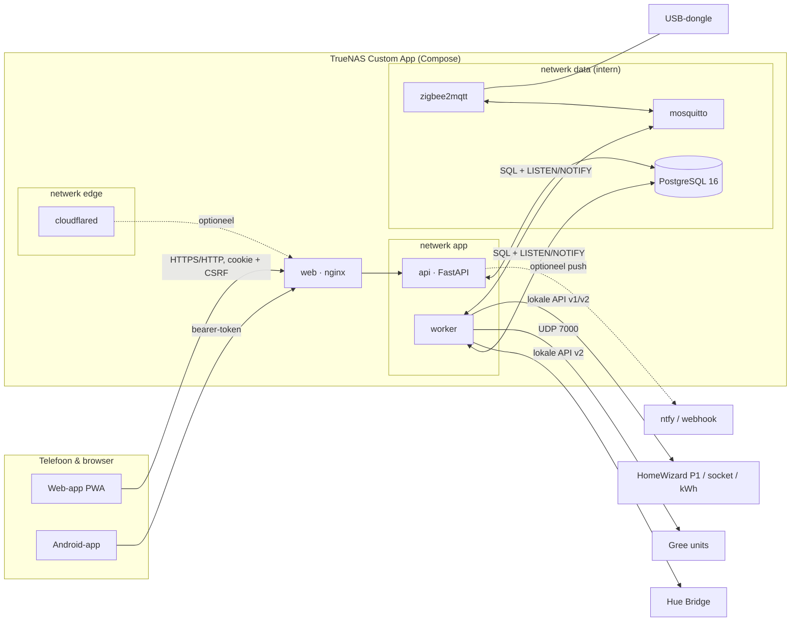

# Architectuur

## Rollen van de onderdelen

- **web (nginx):** serveert de PWA en stuurt `/api` en de WebSocket door. Enige gepubliceerde poort
  (standaard 8088). Remt inlogpogingen (10 per minuut per IP), laat uploads voor herstel tot 2 GB toe
  en toont een Nederlandse pagina *De app start of wordt bijgewerkt…* zolang de API niet antwoordt.
- **api:** login, rechten, validatie, beleidscontrole, overzichten. Praat nooit zelf met apparaten,
  behalve bij zoeken, koppelen en de leestest. Commando's gaan als `queued` de database in. Voert bij het
  starten de databasemigraties uit (met een dump vooraf). Houdt ook de hartslag van de worker en de
  back-ups in de gaten: melding, `status.updated` en het optionele push-bericht buiten de app.
- **worker:** de enige die met apparaten praat. Pollt en abonneert, slaat metingen idempotent op, voert
  commando's uit na een tweede beleidscontrole, draait de klimaatregelaar, de waakhond per zone,
  experimenten, uuraggregaten en opruimen, de klokcontrole en de automatische back-ups (in een apart
  proces).
- **PostgreSQL:** alle gegevens, inclusief tijdreeksen en uurtotalen. LISTEN/NOTIFY verbindt api en
  worker zonder extra broker.
- **mosquitto + zigbee2mqtt:** Zigbee-sensoren, alleen intern bereikbaar. De app mag alle
  Zigbee-berichten lezen, maar alleen nieuwe apparaten toelaten en apparaten hernoemen.
- **cloudflared (optioneel):** de tunnel voor buiten huis. Ziet alleen nginx.

## Netwerken

| Netwerk | Wie | Waarom |
|---|---|---|
| `edge` (`<prefix>.250.0/29`) | cloudflared, web | De tunnel kan niets anders bereiken dan nginx |
| `app` (`<prefix>.251.0/28`) | web, api, worker | Ook de weg naar je apparaten in het thuisnetwerk en naar NTP |
| `data` (`<prefix>.252.0/27`, intern) | api, worker, db, mosquitto, zigbee2mqtt | Geen route naar buiten |

`<prefix>` is standaard `172.30` (`--net-prefix` / `SHC_NET_PREFIX`). nginx gelooft
`CF-Connecting-IP` en `X-Forwarded-Proto` alleen van cloudflared (`.250.2`) en de API gelooft
`X-Forwarded-*` alleen van nginx (`.251.2`). Bij koppelen weigert de API adressen in deze drie
netwerken.

## Gezondheid en herstel

- Elke container heeft een geheugengrens, draait als gewone gebruiker met een alleen-lezen
  bestandssysteem en `cap_drop: ALL`, en herstart vanzelf (`restart: unless-stopped`).
- De worker schrijft elke 30 seconden een hartslag (in de database en voor de healthcheck). Elke lus
  meldt wanneer hij voor het laatst klaar was. Blijft een lus hangen, dan stopt een waakhond-thread het
  proces, zodat Docker een nieuwe worker start.
- Fouten in een lus (database weg, MQTT weg, bridge offline) worden gelogd; de lus gaat met backoff
  verder. Een koppeling gaat pas op *fout* na 3 mislukte pogingen of 5 minuten.
- Tijdens een herstel staat de **onderhoudsmodus** aan: de worker pauzeert. Na een herstel staat de
  **veilige modus** aan: geen commando's tot een beheerder bevestigt.

## Architectuurbesluiten

| # | Besluit | Waarom |
|---|---|---|
| 1 | Monorepo met Python-backend en TypeScript-web | Plan §2; één versie (`VERSION`) voor alles |
| 2 | PostgreSQL ook voor tijdreeksen (index op apparaat/meting/tijd) plus uurtotalen | Eén database om te back-uppen; volume (enkele meters, minuten-resolutie) is klein. Pagina's lezen uurtotalen, niet alle ruwe metingen |
| 3 | Worker is de enige eigenaar van apparaatverbindingen | Geen dubbele sessies naar de bridge/units, één plek voor rate limits en readback |
| 4 | Commando's via een databasetabel | Auditbaar, overleeft herstart; beleidscontrole zowel bij aanvraag als vlak voor verzenden; een commando is pas "bevestigd" na readback |
| 5 | Eigen Gree-protocolimplementatie | Geen Home Assistant nodig, geen GPL-afhankelijkheid; gate: zonder geslaagde bind + readback geen bediening |
| 6 | Klimaatregelaar als pure functie | Volledig testbaar; prioriteiten uit plan §5 in code vastgelegd |
| 7 | Energie uit cumulatieve tellers, niet uit vermogen | Nauwkeurig, robuust bij gemiste polls; resets, uitschieters en zomertijd expliciet afgehandeld |
| 8 | Rollen los van fysieke apparaten (bindings met geldigheid) | Apparaat vervangen of verhuizen zonder historie te verliezen |
| 9 | Native Android (Kotlin/Compose) met gedeelde pure-Kotlin kern | Widgets en meldingen; logica testbaar zonder Android SDK |
| 10 | Cloudflare Tunnel optioneel, standaard uit | Gebruikerswens buiten huis, zonder poorten te openen; LAN-first blijft de standaard |
| 11 | Back-ups en herstel in een apart proces, gestreamd | Vlak geheugengebruik; de worker en de API blijven werken |
| 12 | Beheer van gebruikers, telefoons en back-ups alleen via een web-sessie met wachtwoord | Een gestolen telefoon kan geen nieuwe toegang of back-up maken |

## Klimaatregeling in het kort

Volgorde: (1) hardwaregrenzen en gedeelde buitenunit → (2) handmatige bediening (app, knop of
afstandsbediening) → (3) is de sensor geldig? → (4) schema of comfortprofiel → (5) begrensde bijsturing
van het setpoint.

- Zet je de unit uit met de afstandsbediening, dan blijft hij uit tot je in de app *Terug naar schema*
  kiest.
- Is de sensor verouderd of onwaarschijnlijk, dan stopt de bijsturing en regelt de airco op zijn eigen
  sensor.
- Nooit aan/uit pendelen om comfort te halen; alleen het setpoint, met maximale sprong, minimale tijd
  tussen wijzigingen en maximaal aantal starts per uur.
- Een schemablok zonder modus verandert alleen de doeltemperatuur en zet een uitgeschakelde unit nooit
  aan.
- **Waakhond:** komt de temperatuur binnen de ingestelde tijd (standaard 60 minuten) niet genoeg
  dichter bij het doel, dan volgt een melding. Zonder externe sensor gebruikt de waakhond de sensor van
  de unit zelf.
- Na een herstart stuurt de worker niets tot de actuele stand van de unit is uitgelezen.
