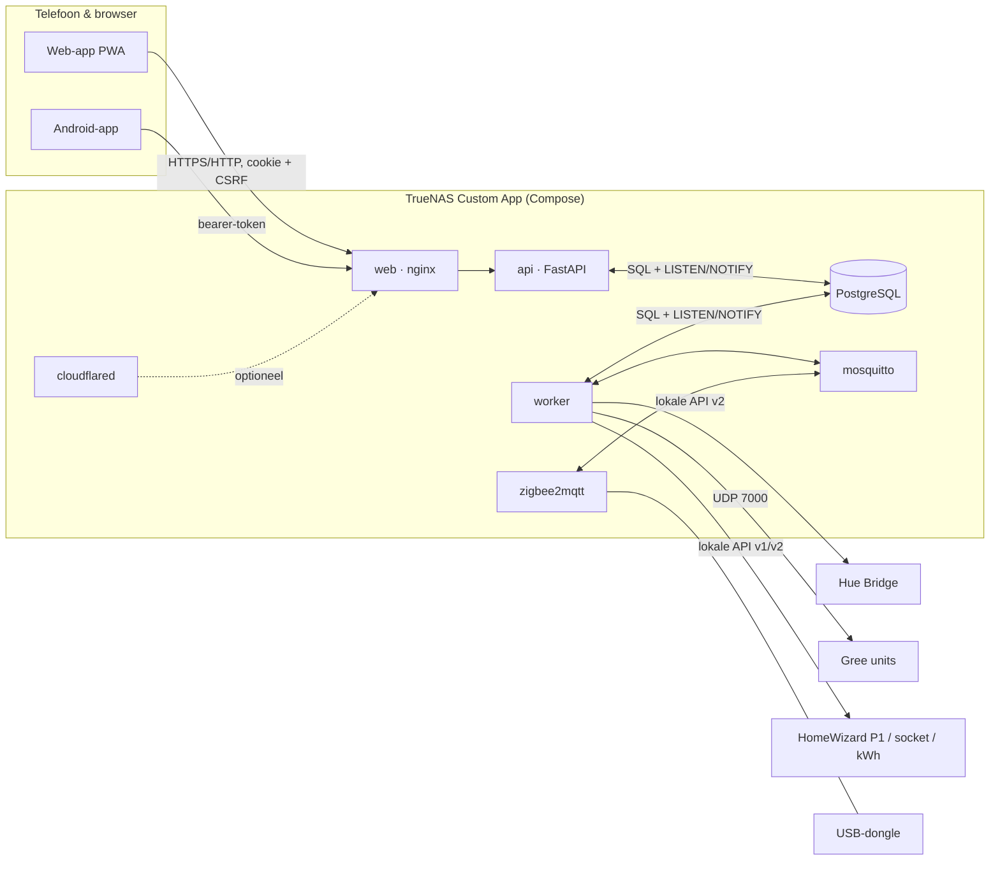

# Architectuur

## Rollen van de onderdelen

- **web (nginx):** serveert de PWA en stuurt `/api` en de WebSocket door. Enige gepubliceerde poort.
- **api:** login, rechten, validatie, beleidscontrole, overzichten. Praat nooit zelf met apparaten, behalve bij zoeken en koppelen. Commando's gaan als `queued` de database in.
- **worker:** de enige die met apparaten praat. Pollt en abonneert, slaat metingen idempotent op, voert commando's uit na een tweede beleidscontrole, draait de klimaatregelaar, alarmen en back-ups.
- **PostgreSQL:** alle gegevens, inclusief tijdreeksen. LISTEN/NOTIFY verbindt api en worker zonder extra broker.
- **mosquitto + zigbee2mqtt:** Zigbee-sensoren, alleen intern bereikbaar.

## Architectuurbesluiten

| # | Besluit | Waarom |
|---|---|---|
| 1 | Monorepo met Python-backend en TypeScript-web | Plan §2; één versie voor alles |
| 2 | PostgreSQL ook voor tijdreeksen (index op apparaat/meting/tijd) | Eén database om te back-uppen; volume (enkele meters, minuten-resolutie) is klein. TimescaleDB kan later. |
| 3 | Worker is de enige eigenaar van apparaatverbindingen | Geen dubbele sessies naar de bridge/units, één plek voor rate limits en readback |
| 4 | Commando's via een databasetabel | Auditbaar, overleeft herstart; beleidscontrole zowel bij aanvraag als vlak voor verzenden |
| 5 | Eigen Gree-protocolimplementatie | Geen Home Assistant nodig, geen GPL-afhankelijkheid; gate: zonder geslaagde bind + readback geen bediening |
| 6 | Klimaatregelaar als pure functie | Volledig testbaar; prioriteiten uit plan §5 in code vastgelegd |
| 7 | Energie uit cumulatieve tellers, niet uit vermogen | Nauwkeurig, robuust bij gemiste polls; resets en zomertijd expliciet afgehandeld |
| 8 | Rollen los van fysieke apparaten (bindings met geldigheid) | Apparaat vervangen of verhuizen zonder historie te verliezen |
| 9 | Native Android (Kotlin/Compose) met gedeelde pure-Kotlin kern | Widgets en meldingen; logica testbaar zonder Android SDK |
| 10 | Cloudflare Tunnel optioneel, standaard uit | Gebruikerswens buiten huis, zonder poorten te openen; LAN-first blijft de standaard |

## Klimaatregeling in het kort

Volgorde: (1) hardwaregrenzen en gedeelde buitenunit → (2) handmatige bediening (app of afstandsbediening) → (3) is de sensor geldig? → (4) schema → (5) begrensde bijsturing van het setpoint.

- Zet je de unit uit met de afstandsbediening, dan blijft hij uit tot je in de app *Hervat* kiest.
- Is de sensor verouderd of onwaarschijnlijk, dan stopt de bijsturing en regelt de airco op zijn eigen sensor.
- Nooit aan/uit pendelen om comfort te halen; alleen het setpoint, met maximale sprong, minimale tijd tussen wijzigingen en maximaal aantal starts per uur.
- Na een herstart stuurt de worker niets tot de actuele stand van de unit is uitgelezen.
